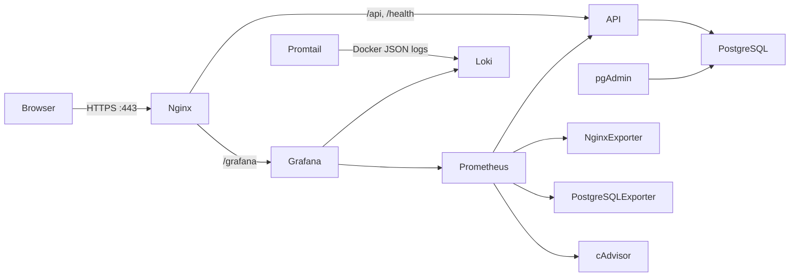

# Task Tracker — Đề tài 24

Ứng dụng quản lý công việc cá nhân/nhóm, triển khai bằng Docker Compose.
Frontend React/Vite, API Node.js/Express và PostgreSQL; pgAdmin quản trị CSDL.
Nginx làm reverse proxy HTTPS; Prometheus/Grafana thu thập và hiển thị
metrics; Loki/Promtail tập trung log và truy vấn bằng LogQL.

Bản thảo báo cáo tiếng Việt (có thông tin sinh viên và ảnh demo cần bổ sung)
ở [REPORT.md](./REPORT.md).

## Kiến trúc



Các mạng Compose được tách thành `edge`, `database` và `monitoring`. Backend
API và PostgreSQL không publish cổng ra host. pgAdmin, Prometheus và Grafana
chỉ bind trên `127.0.0.1`; website đi qua Nginx.

## Yêu cầu chạy

- Docker Desktop với Linux containers (Windows/macOS) hoặc Docker Engine có
  hỗ trợ Docker API v1.44 trở lên.
- Docker Compose v2 (`docker compose`).
- Cổng 80, 443, 3000, 5050 và 9090 chưa bị ứng dụng khác chiếm dụng.
- RAM nên từ 4 GB vì stack có PostgreSQL, Grafana, Prometheus, Loki và
  cAdvisor.

## Cấu hình bí mật

1. Sao chép `.env.example` thành `.env` nếu chưa có. Nếu đã có `.env`, **không
   ghi đè**: bổ sung/cập nhật các biến PostgreSQL, PostgreSQL admin, pgAdmin và
   Grafana từ mẫu.
2. Thay mọi chuỗi `replace_with_...` bằng mật khẩu ngẫu nhiên riêng biệt,
   dài tối thiểu 20 ký tự; không dùng chung mật khẩu giữa database, pgAdmin
   và Grafana.
3. Không commit `.env`, không đưa mật khẩu vào ảnh chụp màn hình hoặc báo cáo.
   `.env` đã nằm trong `.gitignore`.

`DB_USER` là role ứng dụng PostgreSQL riêng, không phải superuser.
`DB_MONITOR_USER` là role exporter riêng, được cấp `pg_monitor` và quyền
kết nối DB để đọc metrics. `POSTGRES_USER` là superuser quản trị nội bộ
container; chỉ `DB_USER` sở hữu database ứng dụng. `PGADMIN_DEFAULT_EMAIL`
là tài khoản đăng nhập pgAdmin, không phải tài khoản PostgreSQL.

## Khởi động toàn bộ hệ thống

Từ thư mục gốc:

```powershell
docker compose config
docker compose up -d --build
docker compose ps
```

Container API chờ PostgreSQL khỏe, khởi tạo schema có tính lặp an toàn rồi mới
khởi động HTTP server. Lần đầu sẽ tải image và build frontend/backend nên có
thể mất vài phút.

| Thành phần | Địa chỉ | Ghi chú |
| --- | --- | --- |
| Website | <https://localhost> | Chứng thư tự ký; trình duyệt sẽ cảnh báo lần đầu |
| Website HTTP | <http://localhost> | Chuyển hướng sang HTTPS |
| API health | <https://localhost/health> | Health check qua Nginx |
| pgAdmin | <http://localhost:5050> | Chỉ truy cập từ máy local |
| Grafana | <https://localhost/grafana/> | Dashboard và Explore |
| Prometheus | <http://localhost:9090> | Chỉ truy cập từ máy local |

Đăng nhập pgAdmin bằng `PGADMIN_DEFAULT_EMAIL`/`PGADMIN_DEFAULT_PASSWORD`,
sau đó đăng ký server:

- **Host name/address:** `postgres`
- **Port:** `5432`
- **Maintenance database:** giá trị `DB_NAME` (mặc định `task_tracker`)
- **Username:** giá trị `DB_USER` (mặc định `task_tracker`)
- **Password:** giá trị `DB_PASSWORD`

Grafana dùng `GRAFANA_ADMIN_USER` và `GRAFANA_ADMIN_PASSWORD`. Dashboard
**Task Tracker - System Overview** được provision tự động. Khi mở website
HTTPS lần đầu, chấp nhận ngoại lệ chứng thư tự ký để trình duyệt cho phép
cookie phiên `Secure`.

## Tạo tài khoản Admin ứng dụng

Đặt ba biến môi trường `ADMIN_EMAIL`, `ADMIN_NAME`, `ADMIN_PASSWORD` trong
PowerShell rồi chạy lệnh one-off sau (mật khẩu không được lưu trong source):

```powershell
$env:ADMIN_EMAIL = "admin@example.edu"
$env:ADMIN_NAME = "System Admin"
$env:ADMIN_PASSWORD = "Use-A-Unique-Strong-Password-123"
docker compose run --rm --no-deps -e ADMIN_EMAIL -e ADMIN_NAME -e ADMIN_PASSWORD api node backend/src/create-admin.js
Remove-Item Env:ADMIN_EMAIL, Env:ADMIN_NAME, Env:ADMIN_PASSWORD
```

Mật khẩu phải dài ít nhất 12 ký tự, tối đa 72 byte. Không dùng mật khẩu ví dụ
trong môi trường thật. Có thể tạo tài khoản người dùng thường từ trang đăng ký.

## Giám sát Prometheus/Grafana

Prometheus scrape định kỳ:

- `api:3001/metrics`: số lượng request, thời gian xử lý HTTP và metrics Node.js.
- `nginx-exporter:9113`: thống kê truy cập Nginx.
- `postgres-exporter:9187`: tình trạng PostgreSQL và kết nối.
- `cadvisor:8080`: CPU/RAM và trạng thái container.

Trong Prometheus, kiểm tra **Status → Targets** hoặc chạy PromQL:

```promql
up
rate(http_request_duration_seconds_count{route!="/metrics"}[5m])
container_memory_working_set_bytes{name!=""}
pg_up
rate(nginx_http_requests_total[5m])
```

Dashboard Grafana có panel request rate, latency p95, CPU/RAM container,
PostgreSQL availability và Nginx request rate. Một số panel cần có traffic
hoặc metrics exporter khỏe mới hiện dữ liệu.

## Log tập trung và LogQL

Promtail dùng Docker API v1.44 để khám phá container trên các Docker Engine
hiện hành, rồi đọc log JSON của Docker từ
`/var/lib/docker/containers/*/*-json.log`, sau đó gửi vào Loki. Trên Docker
Engine Linux, mở Grafana → **Explore** → datasource **Loki** và chạy:

```logql
{job="docker"}
{job="docker"} |= "error"
{job="docker"} |~ "(?i)(error|fail|exception)"
```

Nếu truy vấn chưa có dữ liệu, tạo traffic bằng cách mở website/đăng nhập, chờ
Promtail scrape, rồi chọn khoảng thời gian phù hợp. Docker Desktop trên Windows
chạy engine trong VM; nếu đường dẫn log không được mount bởi bản Docker Desktop
đang dùng, kiểm tra trạng thái Promtail và phần log driver trong
`docker compose logs promtail`. Việc thu thập log file phụ thuộc Docker engine
cấu hình `json-file`.

## Ứng dụng

- Đăng ký/đăng nhập, session cookie `HttpOnly` và `Secure` khi production,
  đổi mật khẩu và đặt lại qua SMTP tùy chọn.
- CRUD công việc, ngày bắt đầu/hạn, trạng thái, ưu tiên, người phụ trách,
  tìm kiếm/lọc/phân trang.
- Dashboard, lịch, thống kê tiến độ và hồ sơ cá nhân.
- Phân quyền Admin, quản lý thành viên và nhật ký hoạt động.
- Mỗi task được truy cập theo chủ sở hữu đã xác thực; mật khẩu hash bằng
  bcrypt; truy vấn SQL tham số hóa.

Schema PostgreSQL đặt tại `database/schema.sql`; `npm run db:init` khởi tạo
schema và `npm run db:check` kiểm tra kết nối khi chạy local.

## Hardening đang áp dụng

1. API và Nginx chạy non-root; API không publish cổng trực tiếp.
2. `cap_drop: ALL`, `no-new-privileges`, filesystem read-only và `/tmp` tạm
   cho API/Nginx.
3. Tách network database (internal), monitoring (internal), edge; chỉ Nginx
   nhận truy cập web từ bên ngoài.
4. Role PostgreSQL của ứng dụng không phải superuser; mật khẩu tách theo dịch
   vụ, lưu trong `.env` không commit.
5. PostgreSQL và Loki không publish port; giao diện pgAdmin/Grafana/Prometheus
   bind loopback.
6. Nginx TLS 1.2/1.3, chuyển HTTP sang HTTPS, security headers, ẩn phiên bản.
   Chứng thư tự ký chỉ dành cho demo/local; thay bằng chứng thư tin cậy khi
   triển khai thật.
7. cAdvisor/Promtail có quyền đọc host metrics/logs cần thiết; đây là thành
   phần giám sát có quyền cao hơn ứng dụng và được giới hạn mount chỉ đọc,
   không publish cổng.

Stack này phục vụ bài tập/demo. Không dùng cấu hình mặc định hoặc chứng thư
tự ký này làm cấu hình production công khai.

## Kiểm thử và rà soát

```powershell
npm test
npm run lint
npm run build
npm run test:integration
```

Test tích hợp yêu cầu `.env` trỏ tới PostgreSQL đã khởi tạo. Với Compose, API
image có test suite và kết nối DB qua mạng nội bộ:

```powershell
docker compose run --rm --no-deps api node --test tests/postgres-integration.test.js
```

Unit test và build không thay thế kiểm chứng từng giao diện demo.

## Lệnh vận hành

```powershell
docker compose logs -f api nginx postgres
docker compose logs -f prometheus grafana loki promtail
docker compose restart api
docker compose down
```

`docker compose down` giữ các volume dữ liệu. Lệnh
`docker compose down -v` xóa vĩnh viễn database, dashboard và metrics; chỉ dùng
khi đã sao lưu và thực sự muốn xóa dữ liệu.

## Hạn chế và dữ liệu cũ

Hệ thống trước đây dùng MySQL; schema mới là PostgreSQL và không tự chuyển dữ
liệu MySQL cũ. Nếu cần giữ dữ liệu, sao lưu database cũ và thực hiện migration
riêng có đối chiếu khóa, kiểu dữ liệu, timestamp và hash trước khi chuyển
traffic. Không xóa database cũ cho đến khi đã xác minh dữ liệu mới.

Stack cung cấp self-signed HTTPS và lưu log/metrics trên named volumes, chưa
bao gồm backup tự động, chứng thư CA tin cậy, retention production hay cảnh báo
Alertmanager.
